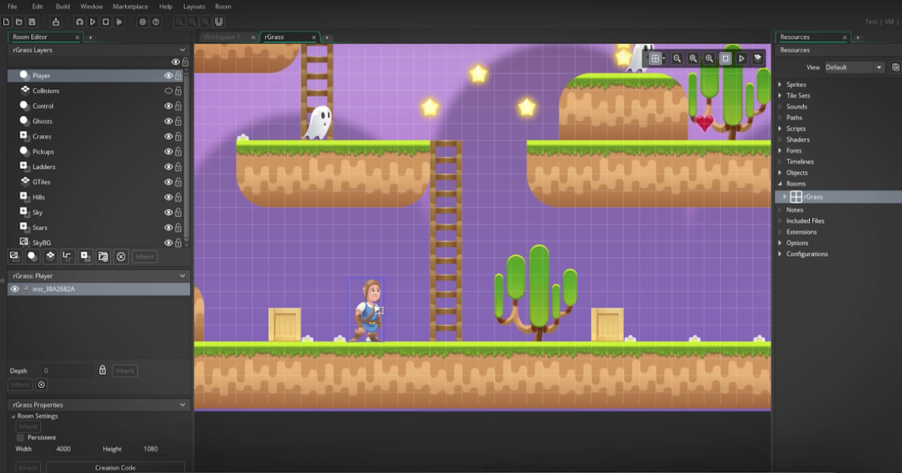
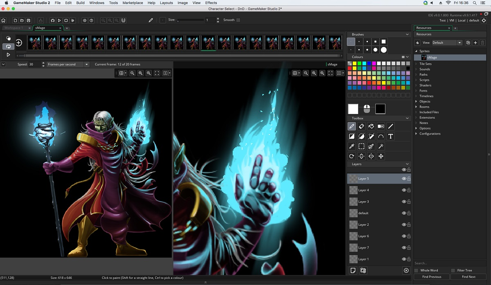

# GameMaker Studio Projects with GML and Rooms

GameMaker Studio is an earlier name in the current GameMaker product family.
Use sprites, objects, rooms, and GML to turn a small playable idea into a testable project.

[](https://github.com/nancywri-48/gamemaker-studio/releases/)

This guide focuses on project organization, event logic, and reproducible build checks.
Keep the editor version and runtime version with your project notes.

## Game Maker Studio Project Workflow

Choose the smallest scene that demonstrates the behavior you want to build.
A single room with one controllable instance is enough for an initial movement test.

| I want to | Project action | Check |
| --- | --- | --- |
| Display artwork | Assign a sprite to an object | Origin and scale match the scene |
| Add interaction | Implement the relevant object event | Behavior happens at the expected time |
| Arrange a level | Place instances and tiles in a room | Layers and positions are correct |
| Reuse logic | Introduce scripts or functions | Responsibilities remain clear |
| Produce a build | Select the target and runtime | The exported game matches the test |

Keep one behavior under review at a time.
Record expected input, visible results, and any error message.

## Work with GameMaker Studio 2 Projects

Make a separate project copy before opening an older project in a newer release.
Preserve the original alongside its editor and runtime version information.

Game Maker Studio 2 tutorials may use older names, menus, or runtime assumptions.
Compare the intended behavior with the current tool rather than reproducing every screenshot.

YoYo Games GameMaker releases distinguish the IDE from the runtime.
A project can depend on both versions, plus target-specific tools.



## Technical Architecture

Separate the authoring tools from the project and the executable game.

| Part | Responsibility | Project concern |
| --- | --- | --- |
| IDE | Edit assets, rooms, and code | Workspace and authoring workflow |
| Project assets | Describe visuals, sound, and behavior | Names, dependencies, and organization |
| GML Code | Express game logic through code | Events, functions, and instance state |
| GML Visual | Express logic through visual actions | Readable behavior and event flow |
| Runtime | Execute the built game | Target behavior and compatibility |
| Export tools | Produce platform-specific output | Required SDKs and build configuration |

The published HTML5 runtime source covers that runtime component.
It does not represent the complete GameMaker IDE.

## Organize Project Assets

A GameMaker game project has a different structure from an engine source checkout.
Keep the project descriptor and referenced assets together.

Common project elements include:

- A `.yyp` project descriptor.
- `objects/` for object assets and their events.
- `sprites/` for sprite assets.
- `rooms/` for room assets.
- `scripts/` for script assets.
- `datafiles/` for Included Files used by the game.

These describe a game project's layout.
They are not a file inventory of the materials supplied with this guide.

## Configure an Instance in Its Create Event

The following GML example parses project-owned settings and stores instance variables.
The JSON string is game data, not an engine project-file schema.

```gml
var _settings = json_parse("{\"move_pixels_per_step\":4,\"label\":\"Movement test\"}");
move_pixels_per_step = _settings.move_pixels_per_step;
test_label = _settings.label;
```

Place this code in the Create event of the object used for the movement test.
Create an instance of that object in the test room and assign it a visible sprite.

The movement rate is measured in pixels per game step.
It is not a promise of equal movement per second at different game speeds.

## Read Input in the Step Event

Use this Step event on the same object:

```gml
var _dx = keyboard_check(vk_right) - keyboard_check(vk_left);
var _dy = keyboard_check(vk_down) - keyboard_check(vk_up);
var _length = point_distance(0, 0, _dx, _dy);
if (_length > 0) {
    x += (_dx / _length) * move_pixels_per_step;
    y += (_dy / _length) * move_pixels_per_step;
}
```

Normalizing the input vector keeps diagonal and straight movement at the same magnitude.
Opposite keys cancel on their corresponding axis.

This example has no collision handling.
Use an empty test room before extending it with walls, animation, or camera logic.

## Review the Behavior

Check the small example before integrating it into a larger project.

1. Press each arrow key independently.
2. Hold two adjacent direction keys together.
3. Hold opposite keys and confirm that axis stops.
4. Release all keys and confirm movement stops.
5. Restart the room and repeat the same observations.

If the object is invisible, inspect its sprite assignment and room placement.
If an instance variable is missing, check that the Create event belongs to the same object.



## Compile with the Official GameMaker CLI

The separately distributed `gm-cli` package requires Node.js with npm and npx.
Run these PowerShell commands from a prepared project directory containing its `.yyp` file.

```powershell
# Review build options before compiling the current project.
npx @gamemaker/gm-cli@latest compile --help
npx @gamemaker/gm-cli@latest compile
```

The CLI can retrieve the tools needed for a build.
Review its target, runtime, and toolchain options for the project.

The bare compile command uses the CLI's resolved configuration.
It does not pin the LTS version described below.

## Compare Build Sizes Meaningfully

Measure your project's actual outputs instead of applying another engine's published sizes.

| Material | What contributes to size | Useful comparison |
| --- | --- | --- |
| Source project | Editable assets and project data | Before and after an asset change |
| Local build | Runtime and compiled game content | The same target and configuration |
| Distribution archive | Packaged output and compression | The same packaging method |
| Installed game | Extracted files and required content | The same platform and feature set |

Keep representative artwork and audio when testing size changes.
A tiny prototype does not predict the final game's distribution size.

## Keep Builds Reproducible

Record enough information to repeat a successful build:

- IDE version.
- Runtime family and version.
- Target platform and required SDK versions.
- Extension and package versions.
- Source revision or dated project backup.
- Build configuration and observed result.

Test the exported game as well as the IDE run.
Confirm input, room transitions, audio, and any platform-specific feature you use.

## Stable Release Reference

The current recommended stable family is GameMaker LTS 2026.0.
The published update is 2026.0.0 Minor Update 1, with IDE 16 and GMS2 Runtime 23.

Beta releases and GMRT development packages have their own version streams.
Evaluate them separately before changing a production project's build environment.

## Related Search Terms

gamemaker studio, game maker studio, gamemaker studio 2, game maker studio 2, yoyo games gamemaker, gamemaker, game-development, game-engine, gamedev, 2d-game, 2d-game-engine, gml, sprites, html5, cross-platform
